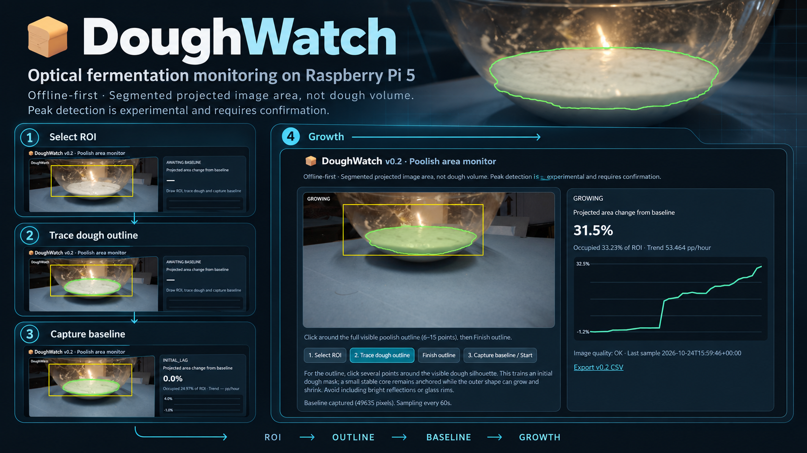
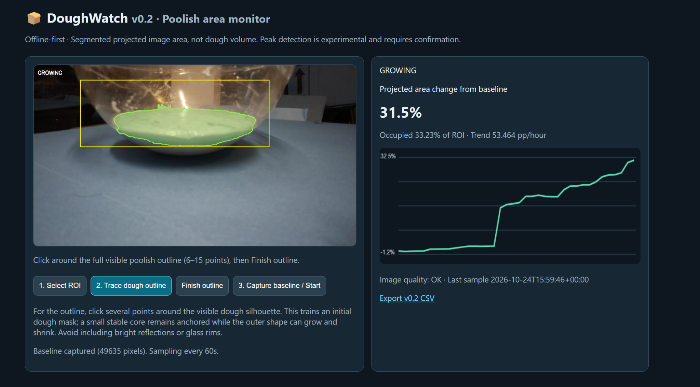
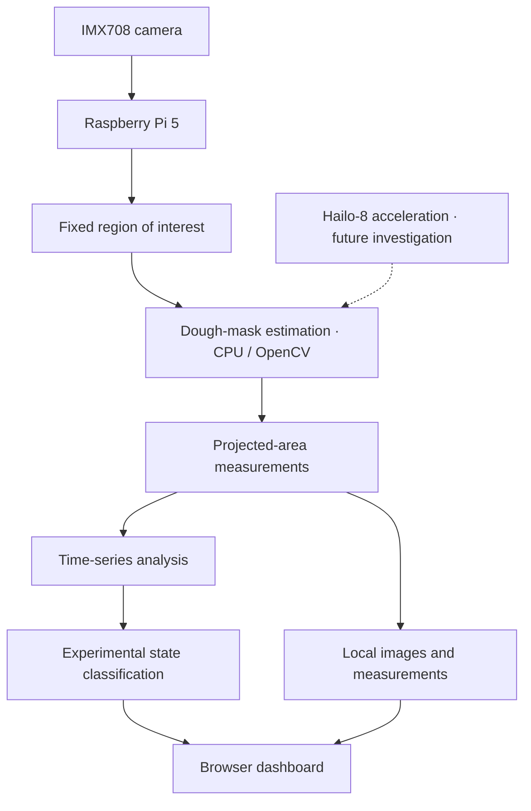
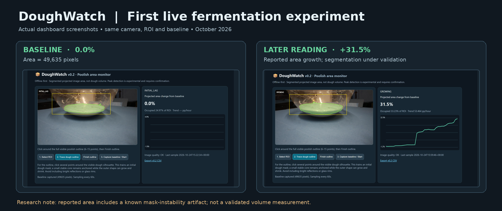

# DoughWatch

*Project showcase graphic composed from prototype screenshots; it is a presentation illustration, not an unmodified scientific capture.*

**Optical fermentation intelligence at the edge.**

DoughWatch is an experimental, camera-based fermentation monitor developed on a **Raspberry Pi 5**. It observes how poolish and other preferments change shape over time, building a growth history to investigate the transition from active expansion to a plateau and eventual decline.

The engineering objective is straightforward: **measure what fermentation is doing, rather than rely only on a timer.**

> **Prototype / research status.** DoughWatch is not yet a validated fermentation-readiness instrument. Current measurements reflect *projected dough area in the camera image*, not physical volume, and require reliability checks before readiness alerts can be trusted.

## First field trial — candidate poolish peak (24 October 2026)

The first live run recorded **150 observations over 2 hours 30 minutes**. The prototype's **smoothed projected-image-area signal** reached **+77.53%** at **21:20 Dubai time**, then ended **6.22 percentage points below that maximum**. A separate v0.2.1 offline tracker replayed all **150 original photographs**, independently locating a candidate peak at **21:23** and a subsequent **6.04-percentage-point decline**. A comparison of three original photographs also found an **approximately 4–6-pixel downward shift** in the apparent upper surface boundary by 21:52. **The candidate peak is now independently reproduced and visually corroborated**, but the image-based measurement is not yet calibrated or reliable enough for automated readiness decisions.

**[↗ Read Field Report 01 — measurements, anomalies, and next validation gates](docs/field-report-2026-10-24.md)**

## Live prototype — October 2026

*Actual running dashboard, not a mockup. The **31.5%** figure is the prototype's reported change in segmented **image area**; it is not a verified dough-volume increase. The experiment contains a known segmentation instability, described below.*

## Why this project exists

A poolish does not follow a universal fermentation schedule. Temperature, yeast activity, hydration, flour, and surrounding conditions affect how rapidly it develops. Its peak is often assessed visually—after expansion slows, the surface stabilizes, and the mixture begins to recede.

DoughWatch explores whether a fixed camera and local image analysis can record this evolution objectively, detect meaningful trends, and eventually provide a practical indication of the peak window.

This is also a field-validation exercise in **edge computer vision**: handling reflections, transparent containers, changes in ambient light, imperfect segmentation, and false readings under real operating conditions.

## The prototype

| Element | Implementation / purpose |
| --- | --- |
| Compute | Raspberry Pi 5 |
| Camera | IMX708 camera, fixed on a transparent bowl |
| Image processing | Python and OpenCV, currently executed on the CPU |
| Observation | User-defined region of interest (ROI) and traced initial dough silhouette |
| Measurement | Segmented, projected dough-occupied area over time |
| Logging | Local measurements and timestamped camera images |
| Interface | Browser dashboard with live preview, mask overlay, trend chart, and CSV export |
| Sampling | One observation per minute in the current experiment |
| Edge accelerator | Hailo-8 AI HAT+ present in the system; **not yet used** by the current segmentation pipeline |

A fixed viewpoint allows the system to observe changes in the same scene without touching the preferment. The aim is to distinguish *actual expansion and contraction* from apparent changes caused by camera noise or segmentation errors.

## System architecture

**Offline-first by design:** acquisition, analysis, and storage are local. The browser provides an inspection interface; cloud connectivity is not required for the core measurement process.

## What the experiment has shown

### Image progression: initial mask to later observation

*Two captures from the same experiment, showing the segmentation and dashboard progression. The later mask and numerical percentage must not be treated as proof of equivalent physical fermentation growth; the first run exposed a measurement artifact.*

The first live run established a **49,635-pixel baseline**, representing **24.97%** of the selected observation window. With one-minute sampling, DoughWatch produced a time series and a real-time highlighted segmentation mask.

The experiment also exposed a critical measurement failure:

| Observation | Recorded result |
| --- | ---: |
| Detected area immediately before the anomaly | 50,425 pixels |
| Detected area one minute later | 57,063 pixels |
| Apparent one-minute increase | **13.16%** |
| Follow-up image comparison | No comparable visible expansion |

The software reported a substantial area increase even though the consecutive photographs appeared nearly unchanged. The working diagnosis is **mask instability**, not a confirmed physical increase in dough size.

**Why that matters:** a dashboard can produce convincing measurements that are nevertheless wrong. Tracking fermentation reliably requires checking whether changes in the mask are supported by changes in the underlying image.

This result directly informs the next design iteration.

## Development status

| Version | Milestone | Status |
| --- | --- | --- |
| **v0.1** | Live camera monitoring; rectangular ROI; single-edge height tracking | Completed proof of concept |
| **v0.2** | User-traced dough silhouette; projected-area monitoring; local time series; experimental fermentation states | First 150-sample field trial recorded; measurement accuracy under validation |
| **v0.2.1** | Independent read-only validator and stabilized offline tracker; complete 150-frame peak replay | Candidate peak reproduced; 71/150 mask updates held; still experimental |
| **Later research** | Hailo-accelerated dough segmentation; evaluation across lighting, bowls, and batches | Planned |

### Current engineering priorities

1. **Measurement stability:** prevent the segmentation mask from jumping when the actual dough silhouette remains stationary.
2. **Confidence and diagnostics:** make uncertain observations visible rather than silently accepting them.
3. **Trend validation:** separate sustained growth, expected initial lag, plateau after growth, and small sustained decline.
4. **Repeatability:** compare multiple fermentation runs before setting practical peak alerts.
5. **Model acceleration:** evaluate whether Hailo-compatible segmentation improves robustness at the edge.

## What “ready” means

The intended signal is not “the dough has doubled.” For poolish, the more useful candidate event is **growth slowing toward a maximum, followed by a small sustained reversal**.

That signal will be treated as a *review prompt*, not an automatic guarantee of optimal readiness. Visual appearance and the fermentation process remain important, and this hypothesis needs testing across repeated batches.

Likewise, a low-activity indication must distinguish an ordinary initial lag from prolonged lack of expansion.

## Public development approach

This repository is a **curated engineering showcase and R&D log**. It documents the system concept, design decisions, prototype milestones, evidence from experiments, and lessons learned.

The complete device application, calibration implementation, and raw experimental data are **not published here at this stage**. Selected demonstrations and technical material may be added as the project matures.

This approach is intentional: reproducible evidence and engineering judgment are more useful than presenting an unvalidated prototype as a finished product.

## Related work

**[Tangzhong Lab](https://github.com/fernando-parodi/tangzhong-lab)** is a browser-based recipe calculator for bread and pizza using a Tangzhong–Poolish formula. DoughWatch explores a complementary problem: observing fermentation behavior during preparation.

---

**Developed by [Fernando Parodi](https://github.com/fernando-parodi)** · Dubai, UAE  
**Project stage:** ongoing experimental development · First live measurements: October 2026
