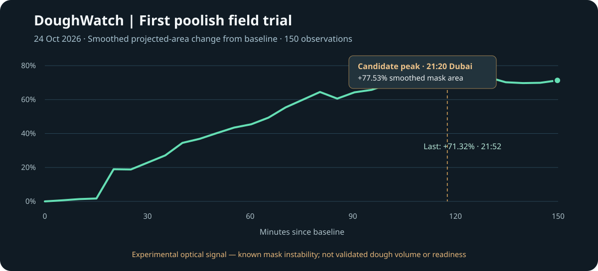

# Field report 01 — First live poolish fermentation run

**Project:** DoughWatch · Raspberry Pi 5 optical fermentation monitor  
**Trial date:** 24 October 2026 · Dubai, UAE (UTC+04:00)  
**Prototype:** v0.2 (CPU-based OpenCV segmentation)  
**Data cut-off:** 21:52:22 Dubai time / 17:52:22 UTC  
**Status:** **Candidate expansion peak observed; physical readiness and measurement accuracy not yet validated**

## Executive finding

The first sustained live run produced **150 timestamped readings over 149.8 minutes**. A masked image-area signal rose from its baseline, reached a **maximum smoothed increase of +77.534% at approximately 21:20 Dubai time**, and ended **6.217 percentage points below that peak** at 21:52.

This pattern is **consistent with a transition from expansion to plateau and possible recession**. It is an encouraging candidate event for DoughWatch's intended use: identifying when a poolish stops rising and begins to settle. It is **not proof of an accurately measured volume peak**, because the v0.2 segmentation has demonstrated false one-minute jumps and the entire late-stage sequence has not yet been independently verified against raw images.

*Chart: sampled points from the exported v0.2 smoothed-area series, with the recorded maximum and final measurement explicitly included. Percentage means change in **detected projected image area relative to the initial mask**, not change in real dough volume. The known false early step remains visible.*

## Experimental setup and method

- **Compute:** Raspberry Pi 5; connected IMX708 camera with a fixed view of a transparent glass bowl containing poolish.
- **Observation:** Operator-selected rectangular ROI with an initial hand-traced dough silhouette; the algorithm estimates foreground pixels corresponding to the visible poolish.
- **Sampling:** Approximately one measurement per minute.
- **Storage:** Local images and measurement records; browser dashboard and CSV export.
- **Processing:** OpenCV/GrabCut segmentation on the Pi CPU. The connected **Hailo-8 accelerator was not used** by v0.2.
- **Sample identifier:** `20261024T152234_205348`. **ROI:** 198,750 image pixels. **Initial detected area:** 49,635 pixels (**24.97% ROI occupancy**).

The experiment tracks **projected image coverage** in a fixed camera view. Bowl curvature, perspective, backlighting, reflections, occlusion, and changing segmentation boundaries prevent treating this signal directly as volumetric expansion.

## Measured timeline

All times in Dubai local time (UTC+04:00) unless otherwise stated.

| Event | Local time | Source observation |
| --- | --- | --- |
| Experiment baseline | **19:22:34** | 49,635 detected pixels, 0% change |
| Previously diagnosed segmentation anomaly | **19:36:39** | Detected area jumped from 50,425 to 57,063 pixels in ~1 minute |
| Highest **smoothed** reported area change | **21:20:11** | **+77.534%** relative to baseline |
| Highest **single-frame raw** reported area change | **21:22:13** | **+81.225%** — less reliable than a sustained trend |
| Latest CSV sample | **21:52:22** | Raw +69.890%; smoothed **+71.317%**; occupancy 42.43% |

From the smoothed maximum to the last logged sample, **approximately 32.18 minutes elapsed**, with a **6.217-percentage-point decrease** in the reported smoothed mask-area signal. Over the final 30 readings, the dashboard's own state classification was **`SLOWING_OR_HOLDING` for 25** and **`GROWING` for 5**.

**Interpretation:** the late-stage signal exhibits a sustained decline from a high point, with small rebounds. That is consistent with a **candidate poolish peak around 21:20–21:25**, subject to inspection of the original camera sequence and comparison against physical fermentation cues (surface bubbles, flattening/recession, aroma, and handling).

## Critical measurement limitation: mask instability

The first run also established a concrete failure mode:

| Consecutive frames | Detected area | Consequence |
| --- | ---: | --- |
| 19:35:39 | 50,425 pixels | Reference |
| 19:36:39 | 57,063 pixels | **+6,638 pixels / +13.16% in one minute** |

Inspection of both saved photographs found no comparable physical change in the poolish silhouette. The most plausible cause was **unstable re-segmentation** rather than actual dough expansion.

Other substantial positive and negative frame-to-frame jumps occurred later. The CSV marks **all 150 samples `quality=OK`**, demonstrating that the existing quality flag does **not** provide adequate protection against this failure mode. Smoothing can reduce noise without eliminating systematic mask errors.

The historical [live dashboard capture](../assets/doughwatch-live-v02.png) and [baseline comparison](../assets/doughwatch-actual-comparison.png) document the prototype's operation, but their reported percentages remain **unvalidated optical measurements**.

## Independent v0.2.1 investigation

A separate, read-only validator and stabilized tracking study were created to avoid disturbing the live camera process or altering the original records:

- A validator replay flagged the original abrupt jump using evidence from near-identical underlying photographs.
- A 20-frame stabilized replay reduced the same event's accepted signal change relative to the original jump.
- In a 60-frame replay, the independent tracker reported **+53.979% provisional area change** with **31/60 mask updates held**.

The high hold rate and later accepted corrections mean that the independent tracker **also requires validation**. These tests demonstrate *anomaly detection*, not a certified ground-truth growth curve. The full 150-frame peak-and-decline window has **not yet been validated with this independent tracker** as of this report.

## Engineering conclusions

1. **End-to-end acquisition demonstrated:** camera, fixed observation zone, local storage, browser visualization, and continuous sampling ran for roughly 2.5 hours in the exported dataset.
2. **A plausible biological transition was captured:** the smoothed projected-area series rises, approaches a high point, and decreases over a sustained later interval.
3. **Readiness is not yet automated:** visual confirmation and a validated measurement signal are required before identifying an actionable fermentation peak.
4. **Quality control must be redesigned:** the existing mask can change without comparable changes in source photography, and `quality=OK` can hide this failure.
5. **Independent offline replay is valuable:** it allows algorithm comparisons without restarting acquisition or rewriting historical readings.

## Next validation gate

**Before claiming reliable peak detection:**

- Replay **the full first run**, including 21:15–21:52 Dubai time, through the stabilized tracker.
- Inspect several *raw* photographs around the candidate peak for physical boundary recession independent of overlays and masks.
- Quantify acceptance/hold rates, false jumps, and sensitivity to changing illumination.
- Improve mask continuity and confidence handling without freezing genuine gradual expansion.
- Repeat with new poolish batches and, where feasible, add a physical reference measurement to estimate real volume.
- Only then enable a conservative **`PEAK_PASSED — REVIEW NOW`** alert with sustained-evidence requirements and clear uncertainty.

## Evidence and provenance

**Source:** v0.2 CSV exported from the user's live run, **150 rows**, timestamps **2026-10-24 15:22:34 to 17:52:22 UTC**. Summary metrics were recomputed from the CSV, not estimated from the graphical screenshot. Data shown here is a curated, numerical research summary; the complete raw dataset and application source remain off the public repository.

This is a **development field report**, not an accuracy certification, commercial performance claim, or food-safety determination.

---

**DoughWatch** · [Repository overview](../README.md) · [Fernando Parodi](https://github.com/fernando-parodi)
